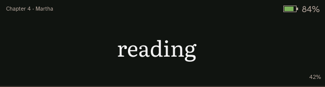
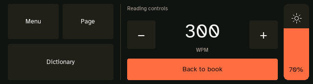
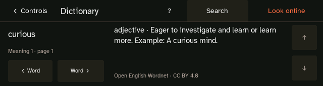

<p align="center">
  <picture>
    <source media="(prefers-color-scheme: dark)" srcset="docs/images/rsvp-nano-dark.svg">
    
  </picture>
</p>

<p align="center"><strong>Your books. Your pace. Your reader.</strong><br>
An open-source pocket reader built on ESP32.</p>

<p align="center">
  <a href="https://ionutdecebal.github.io/rsvpnano/"><strong>Set up your reader</strong></a>
  &nbsp;·&nbsp; <a href="#choose-your-software">Choose your software</a>
  &nbsp;·&nbsp; <a href="https://github.com/ionutdecebal/rsvpnano/releases">Downloads</a>
  &nbsp;·&nbsp; <a href="https://discord.gg/mB5xv2PG53">Join the community</a>
</p>

RSVP Nano brings your books and articles to a small, standalone reader. **Rapid Serial
Visual Presentation (RSVP)** shows text one word at a time; the New UI also offers
contextual word chunks. Set your pace, adjust the timing, and open page view whenever
you want to browse or find your place.

Your library and reading progress live on the microSD card. Everyday reading works
offline, with no account or subscription. The project is free, open source and
community-powered, with detailed settings and room to experiment.

## Choose your software

**Two interfaces, one RSVP Nano project.** Choose the experience that suits you.
Classic remains available, and an ordinary update keeps you on your chosen interface.

| | **0.2.0 · New UI** | **Classic** |
| --- | --- | --- |
| Interface | A quieter reading screen, consolidated menus, larger touch targets and full-area sliders | The established RSVP Nano interface and controls |
| Reading | Single-word RSVP or centred contextual chunks, with adjustable pacing | Single-word RSVP and page reading modes |
| Book navigation | Scrollable page view, text search and chapter jumps; page view is for browsing | Existing page reading and book navigation |
| Quick access | Middle button opens speed, brightness, Dictionary and the main menu | Existing controls for your board |
| First use | On-device introduction to the buttons, speed, pacing, SD card, book uploads and dictionary | Setup through the web companion |
| Focus | Background reading sessions or standalone timers, presets, full-screen breaks and manual resume | Existing focus timers and orientation controls |
| Customisation | Detailed font, theme, tracking and position settings; per-book settings in Library; guides in Word mode | Existing appearance, reader and per-book settings, including guide geometry |
| Dictionary | Offline English definitions and optional direct Wi-Fi lookup | Not included |
| Books and connections | Existing web companion, USB transfers and Wi-Fi | Existing web companion, USB transfers and Wi-Fi |
| Hardware | **Waveshare ESP32-S3 Touch LCD 3.49 Rev1 and Rev2** | [All supported boards below](#supported-hardware) |
| Updates | Rev1: update New UI or choose **Return to Classic**. Rev2: online updates and switching are not published yet | The selector maintenance build adds **Try New UI** on LCD 3.49 Rev1 |
| Availability | **0.2.0 preview**, selected explicitly on Rev1; hardware-tested source preview on Rev2 | Stable; the default installer choice |
| Source | [Rev1](https://github.com/ionutdecebal/rsvpnano/tree/release/ui-dictionary) · [Rev2](https://github.com/ionutdecebal/rsvpnano/tree/work/ui-020-rev2) | [`v0.1.4`](https://github.com/ionutdecebal/rsvpnano/tree/v0.1.4) |

[**New UI 0.2.0 Rev1 downloads**](https://github.com/ionutdecebal/rsvpnano/releases/tag/v0.2.0) ·
[**Rev2 source preview**](#lcd-349-rev2-source-preview) ·
[**Classic downloads**](https://github.com/ionutdecebal/rsvpnano/releases/latest)

**Rev2 is now supported and has been tested on hardware.** Its v0.2.0 port keeps
the same interface, onboarding and dictionary. Rev2 release downloads and installer/OTA
choices will follow separately; the existing `v0.2.0` release files are for Rev1.

This release focuses on the interface, onboarding and dictionary. Voice notes,
transcription, Bluetooth phone sync and the experimental new phone app are being
developed separately and are **not included in 0.2.0**.

<table>
  <tr>
    <td width="50%"><strong>Space to read</strong><br></td>
    <td width="50%"><strong>Your book, one menu away</strong><br></td>
  </tr>
  <tr>
    <td><strong>Controls when you need them</strong><br></td>
    <td><strong>Definitions without leaving the reader</strong><br></td>
  </tr>
</table>

<sub>New UI screens rendered by the firmware’s production renderer with sample content.</sub>

## Get started

You need a [supported board](#supported-hardware), a USB-C **data** cable and a FAT32
microSD card. An 8–32 GB card is a straightforward starting point.

1. Open the [web companion](https://ionutdecebal.github.io/rsvpnano/) in desktop **Chrome or Edge**.
2. Choose your exact board and revision, then **Classic** or **New UI (preview) · 0.2.0** where listed. For New UI on Rev2, use the [source-preview instructions](#lcd-349-rev2-source-preview).
3. Follow the flashing steps. The New UI’s introduction walks you through the controls.
4. Add books from the companion’s Library screen: EPUB, RSVP, text, Markdown, HTML or XHTML.
5. Open a book on the Nano and make the pace your own.

Wi-Fi is optional for reading. Books can be transferred over USB or through the local
Wi-Fi companion. You can replay the New UI introduction under **Settings → Help**.

**Already using a Nano?** Back up your SD card and leave **Erase first** off in the web
installer. Match the firmware to your board revision. For manual browser installation,
use the merged `.bin`; the `-ota.bin` is for application-only OTA updates.

[Setup, connection and installation details →](docs/new-ui-setup.md)

## Updates and switching

On **LCD 3.49 Rev1**, in the New UI’s **Firmware updates**, choose **Check current software** to stay on
New UI, or **Return to Classic** to change interfaces. The reader shows the selected
version before you confirm. It downloads over Wi-Fi and restarts after installation.

Classic **v0.1.3 and later** provides the return journey with **Try New UI** on LCD 3.49 Rev1.
If older firmware reports **rsvp-nano-ota.bin missing**, retry the official update
to Classic **v0.1.4**, then choose **Try New UI** on Rev1. Rev2's public update feed
still supplies Classic; its tested New UI source preview is available separately.
Manual full-flash downloads are bundled in `rsvp-nano-browser-installers.zip`;
the browser installer selects the correct image for your board automatically.
If your Classic version has no selector yet, install the selector-equipped Classic
release first, or choose New UI directly in the web installer. These choices are
available only for compatible hardware.

Rev2 New UI is not in the public update catalog yet. Its update check and
**Return to Classic** will report that the software is not published for that board.
Use the browser installer to return to Classic Rev2 for now. Published Classic Rev2
does not yet offer **Try New UI**; keep a merged Rev2 New UI build for reinstalling it.

Switching installs a different firmware; it is not a live appearance toggle. Both use
the same SD library, but Classic may replace New UI-only preferences when it saves.
Keep an SD backup if you want to restore your exact settings.

[Switching, advanced update sources and manual installation →](docs/new-ui-setup.md#updates-and-switching)

## Dictionary setup (New UI)

**English is available now. More languages are planned.** Install the dictionary once
on your SD card, then look up words offline without a phone, account or server.

- **From the reader:** press the middle button → **Dictionary → ? → Install / manage dictionary**,
  then **Install dictionary**. You can also install it during onboarding. The download
  uses Wi-Fi and takes about **48 MiB** on SD, with progress and verification.
- **From a computer:** download the [English dictionary ZIP](https://github.com/ionutdecebal/rsvpnano/releases/download/dictionary-en-2025.1/RSVP-Nano-English-Dictionary.zip),
  extract it, and copy the `dictionaries` folder to the root of the SD card.

**Look online** is optional: it sends the lookup word directly to Wiktionary over Wi-Fi.
The book is not uploaded. Offline lookup remains available when an online request fails.

The pack is adapted from **Open English Wordnet 2025**. Dictionary data is versioned
separately from firmware, and compatible custom packs can still be copied to SD.
Keep the pack’s attribution and licence files when sharing it.

[Manual installation, custom packs and dictionary licences →](docs/new-ui-setup.md#dictionary-setup-new-ui)

## Supported hardware

**New UI 0.2.0 supports LCD 3.49 Rev1 and Rev2.** Rev2 is currently a
[hardware-tested source preview](#lcd-349-rev2-source-preview). Classic supports the boards below.
Choose the exact board revision when flashing; firmware is not interchangeable.

<details>
<summary><strong>Board list, build targets and purchase links</strong></summary>


| Board | PlatformIO environment | Distribution |
| --- | --- | --- |
| Waveshare ESP32-S3 Touch LCD 3.49 rev1 | `waveshare_esp32s3_touch_lcd_349_rev1` | Web installer, OTA, source |
| Waveshare ESP32-S3 Touch LCD 3.49 rev2 | `waveshare_esp32s3_touch_lcd_349_rev2` | Classic: web installer, OTA, source. New UI: source preview |
| Waveshare ESP32-S3 Touch AMOLED 1.8 V1 | `waveshare_esp32s3_touch_amoled_18_v1` | Web installer, OTA, source |
| Waveshare ESP32-S3 Touch AMOLED 1.8 V2 | `waveshare_esp32s3_touch_amoled_18_v2` | Web installer, OTA, source; still experimental |
| Waveshare ESP32-S3 Touch AMOLED 2.06 | `waveshare_esp32s3_touch_amoled_206` | Web installer, OTA, source |
| Waveshare ESP32-S3 Touch AMOLED 2.16 | `waveshare_esp32s3_touch_amoled_216` | Web installer, OTA, source |
| Waveshare ESP32-S3 Touch AMOLED 2.41 V1 | `waveshare_esp32s3_touch_amoled_241` | Web installer, OTA, source |
| Waveshare ESP32-S3 Touch AMOLED 2.41 V2 | `waveshare_esp32s3_touch_amoled_241_v2` | Web installer, OTA, source; hardware validation pending |
| Waveshare ESP32-C6 Touch LCD 1.47 | `waveshare_esp32c6_touch_lcd_147` | Web installer, OTA, source |

Match the LCD 3.49 firmware to the board revision. Rev1 and Rev2 use different
backlight, display-reset and interrupt wiring; do not interchange their binaries.

For AMOLED 2.41, choose V2 only for a Rev2.0 PCB or V2 QC label. Reset/interrupt wiring
is different; V1 and V2 firmware are not interchangeable. Both use the regular UI.

The following purchase links are affiliate links. A purchase may support RSVP Nano at no extra cost
to you:

- [Touch LCD 3.49](https://www.waveshare.com/esp32-s3-touch-lcd-3.49.htm?&aff_id=ionutdecebal)
- [Touch AMOLED 1.8](https://www.waveshare.com/esp32-s3-touch-amoled-1.8.htm?&aff_id=ionutdecebal)
- [Touch AMOLED 2.06](https://www.waveshare.com/esp32-s3-touch-amoled-2.06.htm?&aff_id=ionutdecebal)
- [Touch AMOLED 2.16](https://www.waveshare.com/esp32-s3-touch-amoled-2.16.htm?&aff_id=ionutdecebal)
- [Touch AMOLED 2.41](https://www.waveshare.com/esp32-s3-touch-amoled-2.41.htm?&aff_id=ionutdecebal)
- [ESP32-C6 Touch LCD 1.47](https://www.waveshare.com/esp32-c6-touch-lcd-1.47.htm?&aff_id=ionutdecebal)

</details>

## RSVP Nano and Pocket Lines

**RSVP Nano continues as the free, community-powered, experimental platform.** We’re
keeping the detailed settings, the DIY and self-hosted possibilities, and development
for existing Waveshare readers.

Alongside it, we’re building **Pocket Lines** for people who want a reader they can
buy and start using straight away: preinstalled software, a simpler device experience
and services that don’t require self-hosting. A dedicated device with an OLED screen,
more physical buttons and a metal casing is in development. These are early plans.

The projects now have separate development tracks and repositories. **Both projects’
software will remain open source.** Our commitment is for every Pocket Lines software
feature to have a DIY or self-hosted equivalent in RSVP Nano as development progresses.
That is the direction of travel, not a claim that every planned feature is available today.

[Join the shared community and help shape what comes next →](https://discord.gg/mB5xv2PG53)

## Companions and your library

The [web companion](https://ionutdecebal.github.io/rsvpnano/) handles setup, flashing,
book conversion, USB transfers and local-network management. Existing
[Android](companion/apps/android/README.md) and
[iOS](companion/apps/ios/RSVPNanoCompanion/README.md) companions can be built from source.
They share the Kotlin conversion and device logic; the experimental new phone app
is a separate development effort.

Books and articles live under `/library/books` and `/library/articles` on the SD card.
Fonts, themes, language packs and settings are stored alongside the library. Reader
indexes can be rebuilt; hidden `.rstate.toml` files preserve progress and per-book settings.
Always eject USB mass storage before disconnecting the reader.

[Configuration and storage](docs/configuration.md) · [Reader fonts](fonts/README.md) ·
[Themes](themes/README.md) · [Language packs](locale-packs/README.md)

## Build and contribute

Bug reports, feature ideas and focused pull requests are welcome. Tell us **Classic
or New UI**, your firmware version, board revision and the steps to reproduce.
Use `main` for Classic firmware work and `release/ui-dictionary` for New UI on Rev1.
The tested Rev2 port lives on `work/ui-020-rev2`.

<details>
<summary><strong>Build firmware and companion apps from source</strong></summary>


Clone submodules first:

```bash
git clone --recurse-submodules https://github.com/ionutdecebal/rsvpnano.git
cd rsvpnano
```

### Firmware

The default `main` branch builds Classic. For the exact Classic maintenance release,
use tag `v0.1.4`. For the exact New UI 0.2.0 release source:

```bash
git fetch --tags
git switch --detach v0.2.0
git submodule update --init --recursive
```

The published `v0.2.0` tag and `release/ui-dictionary` target LCD 3.49 Rev1.
For the tested Rev2 port, use the separate branch below.

Install [PlatformIO](https://platformio.org/), then build one target:

```bash
pio run -e waveshare_esp32s3_touch_lcd_349_rev1
```

Upload to a connected board:

```bash
pio run -e waveshare_esp32s3_touch_lcd_349_rev1 -t upload
```

Run native firmware tests:

```bash
pio test -e native_test
```

### LCD 3.49 Rev2 source preview

The v0.2.0 Rev2 port has passed an owner test on a confirmed Rev2 board, both LCD
revision builds, and update/dictionary checks. A Rev2 1000 WPM benchmark and
on-device firmware switching have not yet been verified.

From a clone of this repository, check out the Rev2 branch and export its firmware:

```bash
git fetch origin
git switch work/ui-020-rev2
git submodule update --init --recursive
python3 tools/export_web_firmware.py --env waveshare_esp32s3_touch_lcd_349_rev2
```

In the web companion, select **LCD 3.49 Rev2 → Choose a firmware file**, then use
`build/firmware/rsvp-nano-esp32-s3-touch-lcd-3.49-rev2.bin`. Keep **Erase first** off
and back up SD settings/progress first. The separate `-ota.bin` is for OTA delivery,
not the browser's merged-file installer. The English dictionary pack is shared
with Rev1; an existing pack can stay on the SD card.

[Rev2 implementation and validation notes →](https://github.com/ionutdecebal/rsvpnano/blob/work/ui-020-rev2/docs/releases/lcd349-rev2-candidate.md)

### Web and mobile companions

Companion builds require JDK 17. Android also requires the Android SDK; iOS requires macOS and Xcode.

```bash
# Browser tests and staged Pages distribution
./gradlew checkWeb

# Shared tests and Android release build
./gradlew checkAndroid

# Shared iOS compilation and simulator tests
./gradlew checkIos
```

The staged website is written to `build/webSite`. Detailed native setup is in the
[Android](companion/apps/android/README.md) and
[iOS](companion/apps/ios/RSVPNanoCompanion/README.md) guides.

</details>

For changes, build the affected target and run the relevant tests. Keep board-specific
behavior in its platform directory and reuse the shared companion/conversion logic.
Include physical-device results when changing display, touch, power, storage or USB.

[Report an issue](https://github.com/ionutdecebal/rsvpnano/issues) ·
[Companion API](docs/companion-api.md) · [USB protocol](docs/companion-serial.md) ·
[Conversion format](docs/conversion/spec.md) · [Hardware architecture](docs/hardware/README.md)

## License

RSVP Nano is distributed under the [MIT license](LICENSE). Fonts and third-party
libraries keep their own licences. Offline dictionary data is based on Open English
Wordnet under CC BY 4.0, with the underlying WordNet notices preserved; online definitions
come from Wiktionary under CC BY-SA 4.0. See the
[dictionary attribution and setup guide](docs/new-ui-setup.md#dictionary-setup-new-ui).
